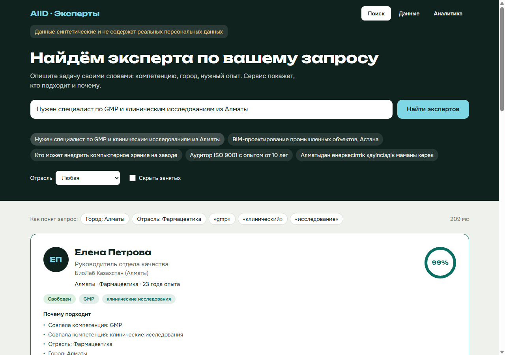

# Подбор экспертов AIID

Сервис находит экспертов Альянса по запросу обычным языком и объясняет выбор. Работает полностью офлайн.

> Демо-прототип. Все данные синтетические и не содержат реальных персональных данных.



## Что умеет

- Запрос на русском (и казахском) вместо фильтров: «нужен специалист по GMP и клиническим исследованиям из Алматы»
- Топ-3+ эксперта с процентом соответствия и причинами: совпавшие компетенции, отрасль, город, опыт
- Занятые эксперты ниже в выдаче, их можно скрыть
- Фильтр по отрасли поверх текстового запроса
- Загрузка своей базы из CSV без перезапуска
- Кнопки «подошёл / не подошёл» влияют на выдачу
- Дашборд востребованных компетенций и «спрос без предложения» (запросы, на которые нет подходящих экспертов)
- «Почему не он?», «Собрать команду», «Похожие эксперты»
- Слабое совпадение честно помечается: на запрос вне базы (например, «юрист по налогам») сервис говорит, что точных совпадений нет

## Точность

Локальная bge-m3, CPU, 4 потока, прогретая модель, без отзывов.

| Набор | Режим | hit@3 | Среднее, мс | p95, мс |
| --- | --- | --- | --- | --- |
| eval_queries.json | hybrid | 7/7 | 182.3 | 205.8 |
| eval_queries.json | bm25 | 6/7 | 176.3 | 187.2 |
| eval_queries.json | vector | 7/7 | 168.3 | 183.3 |
| eval_holdout.json | hybrid | 10/10 | 176.6 | 188.7 |
| eval_holdout.json | bm25 | 10/10 | 173.6 | 187.9 |
| eval_holdout.json | vector | 10/10 | 160.4 | 187.8 |
| eval_jury.json | hybrid | 14/15 | 147.9 | 187.8 |
| eval_jury.json | bm25 | 7/15 | 171.0 | 190.9 |
| eval_jury.json | vector | 15/15 | 168.1 | 201.2 |

Наборы: `eval_queries` (7 запросов с ловушками), `eval_holdout` (10 запросов, написаны вместе с данными: даже BM25 даёт 10/10, поэтому он слабый показатель), `eval_jury` (15 запросов другими словами; релевантность считается правилом по компетенциям, а не по id). Единственный промах гибрида на `eval_jury` — «проектирование электрических сетей для завода»: нужный эксперт стоит первым в обоих списках, но занят (×0,7).

Время включает построение объяснений; даже в режиме BM25 вектор нужен для процента и смысловой близости.
Пересчитать все режимы: `.venv\Scripts\python.exe backend\scripts\eval.py --all`.

## Запуск

Нужны Python 3.11+ (у нас 3.12), Node 20+. База данных не нужна. Windows (PowerShell), из корня репозитория:

```powershell
python -m venv .venv
.venv\Scripts\python.exe -m pip install -U pip "huggingface_hub[cli]"
.venv\Scripts\python.exe -m pip install torch --index-url https://download.pytorch.org/whl/cpu
.venv\Scripts\python.exe -m pip install -r backend\requirements-dev.txt
.venv\Scripts\hf.exe download BAAI/bge-m3 --local-dir backend\models\bge-m3 --exclude "onnx/*" --exclude "imgs/*"   # ~2,3 ГБ, один раз
Copy-Item .env.example .env

cd backend; ..\.venv\Scripts\python.exe -m uvicorn app.main:app   # API: http://localhost:8000/docs
cd web; npm install; npm run dev                                   # UI:  http://localhost:5173
```

Или всё в Docker (модель всё равно скачать заранее командой выше):

```powershell
docker compose up --build   # UI: http://localhost:8080, API: http://localhost:8000/docs
```

macOS / Linux: те же шаги, `source .venv/bin/activate`, затем `pip`, `hf`, `uvicorn` без путей.

## Как это работает

Гибридный поиск: BM25 по леммам ловит точные термины (GMP, BIM), модель эмбеддингов `bge-m3` ловит смысл («испытания» и «исследования»). Списки сливаются через Reciprocal Rank Fusion, затем учитываются город, отрасль и занятость. Обоснование собирается из реальных полей эксперта, без генерации текста. Подробности в [AGENTS.md](AGENTS.md).

## Команда

[Имена и роли]
