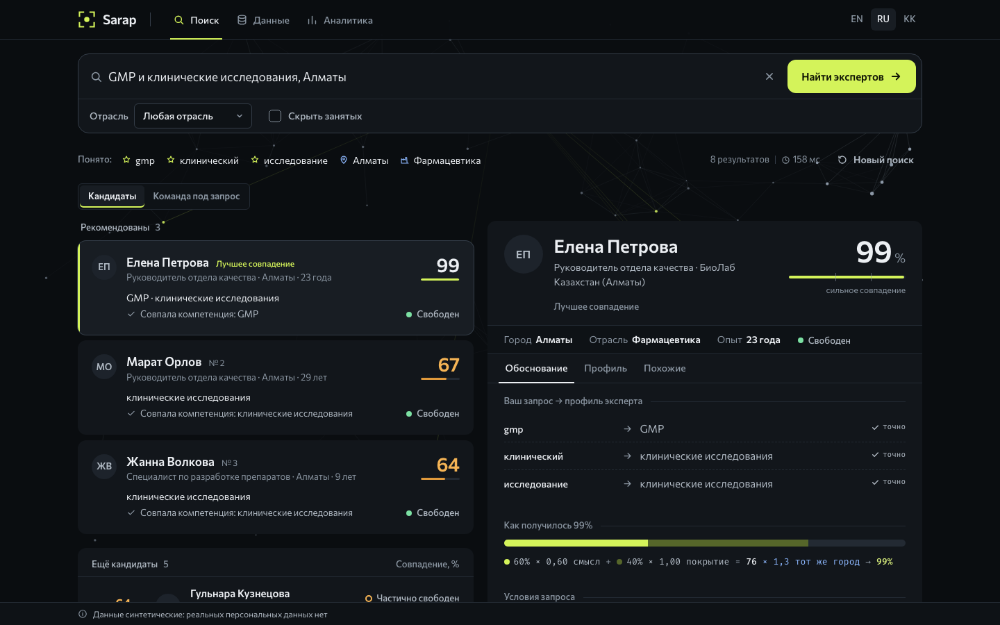
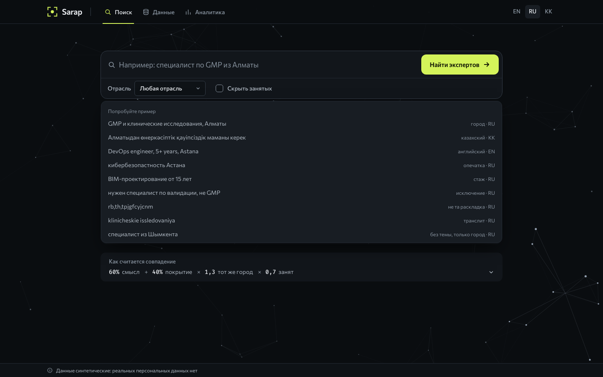
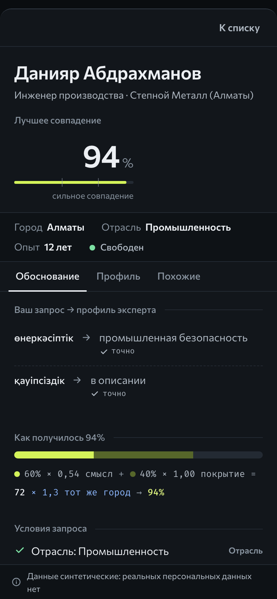
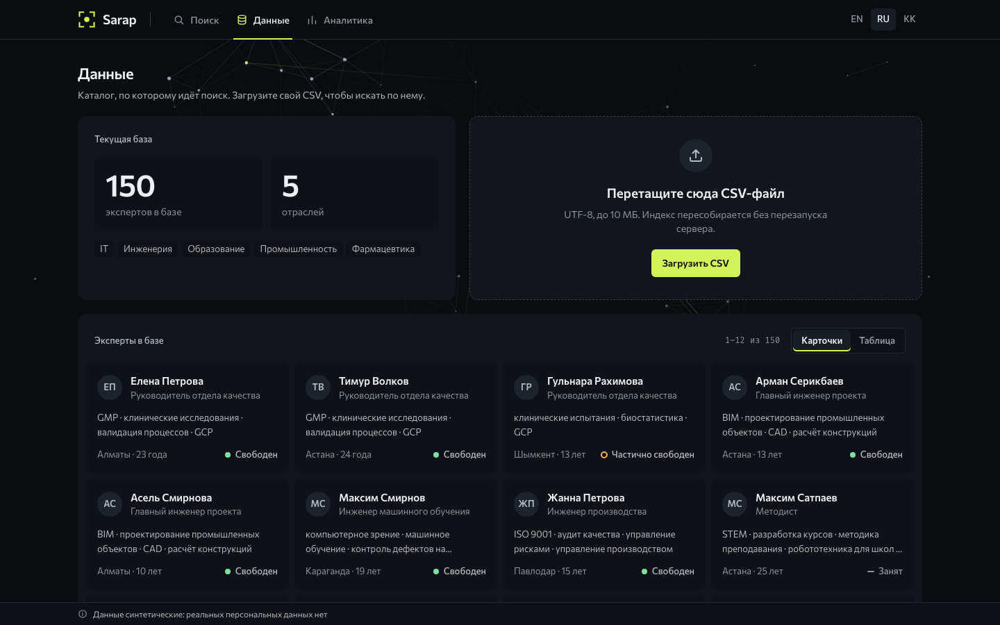
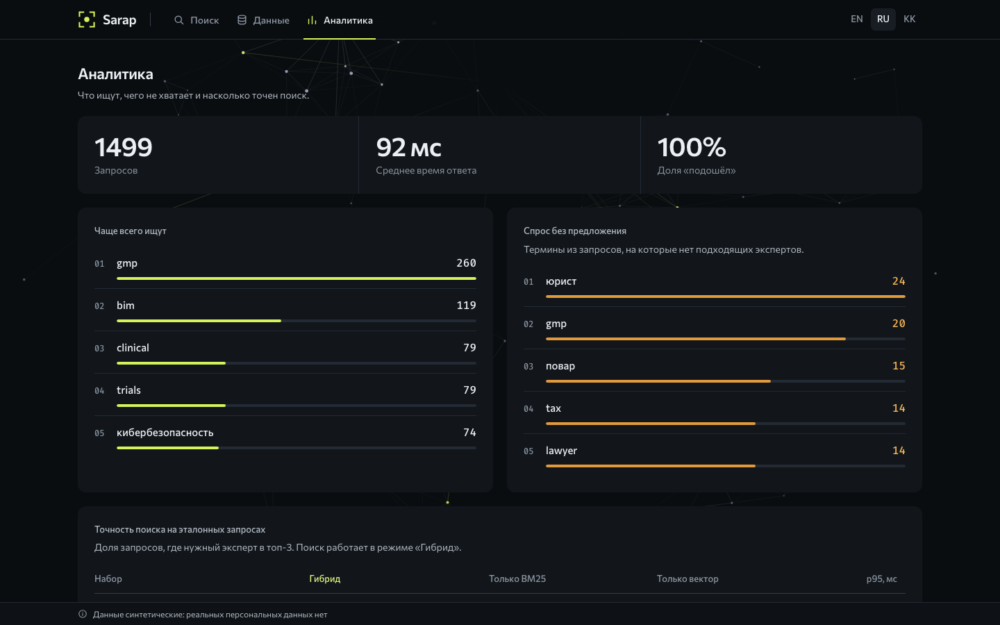

# Sarap: подбор экспертов для AIID

Сервис находит экспертов Альянса по запросу обычным языком и объясняет выбор. Работает полностью офлайн.

> Демо-прототип. Все данные синтетические и не содержат реальных персональных данных.

Прод: [sarap.alimberdi.tech](https://sarap.alimberdi.tech)



| Старт и примеры запросов | Профиль на телефоне |
| --- | --- |
|  |  |
| **Данные: каталог и загрузка CSV** | **Аналитика: спрос и точность** |
|  |  |

## Что умеет

- Запрос обычными словами вместо фильтров: «нужен специалист по GMP и клиническим исследованиям из Алматы». Русский, казахский (в том числе падежи «Алматыдан») и английский
- Понимает живой ввод: опечатки («кибербезопастность»), забытую раскладку («rb,th,tpjgfcyjcnm»), транслит («klinicheskie issledovaniya»), исключения («не GMP»), стаж («от 15 лет»), «свободный сейчас»
- Строка «Понято:» показывает, как разобран запрос: навыки, город, отрасль, условия, исключения
- Топ-3 отдельным блоком и остальные кандидаты списком; у каждого процент соответствия
- Обоснование из полей анкеты, без генерации: какое слово запроса чем подтверждено (точно или по смыслу), как сложился процент, условия запроса
- Учёт занятости: занятые ниже в выдаче, их можно скрыть, а для занятого из топ-3 предлагается свободная замена
- Команда под запрос: 2–3 эксперта, которые вместе закрывают все навыки; похожие эксперты
- Кнопки «подошёл / не подошёл» двигают выдачу по запросам той же темы
- Загрузка своей базы из CSV без перезапуска
- Аналитика: востребованные компетенции, «спрос без предложения», точность на эталонных наборах
- Слабое совпадение честно помечается: «Точных совпадений нет, вот ближайшие»
- Интерфейс на трёх языках (EN, RU, KK); обоснования приходят на выбранном языке
- Тёмная тема, работает на телефоне; фон, где точки это эксперты каталога, реагирует на поиск и курсор

## Точность

Локальная bge-m3, CPU (Apple M-серии), 4 потока, прогретая модель, без отзывов. На Windows-ноутбуке команды запрос занимал 150–250 мс.

| Набор | Режим | hit@3 | Среднее, мс | p95, мс |
| --- | --- | --- | --- | --- |
| eval_queries.json | hybrid | 7/7 | 118.0 | 157.6 |
| eval_queries.json | bm25 | 7/7 | 55.9 | 65.1 |
| eval_queries.json | vector | 6/7 | 56.4 | 65.1 |
| eval_holdout.json | hybrid | 10/10 | 110.4 | 143.1 |
| eval_holdout.json | bm25 | 10/10 | 57.1 | 65.5 |
| eval_holdout.json | vector | 10/10 | 59.0 | 69.6 |
| eval_jury.json | hybrid | 14/15 | 112.4 | 153.8 |
| eval_jury.json | bm25 | 8/15 | 57.2 | 71.0 |
| eval_jury.json | vector | 15/15 | 54.5 | 66.0 |
| eval_english.json | hybrid | 12/12 | 101.2 | 127.5 |
| eval_english.json | bm25 | 12/12 | 57.0 | 67.9 |
| eval_english.json | vector | 12/12 | 59.3 | 68.0 |

Слепой стресс-набор из ~1600 запросов, построенных из каталога (три языка, опечатки, английская раскладка, казахский без казахских букв, города): 96,1% в топ-3; на четырёх чужих каталогах 95,0–100%. Подробности и команды в [docs/test-cases.md](docs/test-cases.md).

Наборы: `eval_queries` (7 запросов с ловушками), `eval_holdout` (10 запросов, написаны вместе с данными: даже BM25 даёт 10/10, поэтому он слабый показатель), `eval_english` (12 запросов на английском), `eval_jury` (15 запросов другими словами; релевантность считается правилом по компетенциям, а не по id). Единственный промах гибрида на `eval_jury` — «проектирование электрических сетей для завода»: нужный эксперт стоит первым в обоих списках, но занят (×0,7).

Время включает построение объяснений; даже в режиме BM25 вектор нужен для процента и смысловой близости.
Тест-кейсы, замеры памяти и скорости, известные недоработки: [docs/test-cases.md](docs/test-cases.md); API-кейсы на запущенном сервере: `backend/scripts/check_cases.py`.

Пересчитать все режимы: `.venv\Scripts\python.exe backend\scripts\eval.py --all`.

## Запуск

### Одной командой (Docker)

Нужен только Docker (Docker Desktop на Windows и macOS или colima). Python и Node не нужны.

```bash
./start.sh        # macOS, Linux
.\start.ps1       # Windows PowerShell
```

Скрипт при первом запуске скачивает модель через Docker (один раз, ~2,3 ГБ, нужен интернет), собирает и поднимает бэкенд и фронт, ждёт готовности и печатает адреса: интерфейс `http://localhost:8080`, Swagger `http://localhost:8080/docs`. Дальше всё работает без сети (проверено запуском бэкенда в контейнере без сетевого интерфейса). Если порт занят: `WEB_PORT=8090 BACKEND_PORT=8010 ./start.sh`. Остановить: `docker compose down`. С других устройств в той же сети: `http://<IP компьютера>:8080`.

То же вручную:

```bash
docker compose --profile setup run --rm model   # один раз: модель в backend/models/bge-m3
docker compose up --build -d
```

Если на Windows `docker compose` пишет `dial tcp 127.0.0.1:2375: connectex: ... refused`, в окружении задана `DOCKER_HOST=tcp://127.0.0.1:2375`, а Docker Desktop не слушает этот порт. Запустите Docker Desktop и дождитесь «Engine running», затем `Remove-Item Env:DOCKER_HOST` (PowerShell).

### Для разработки (venv и Vite)

Нужны Python 3.11+ (у нас 3.12), Node 20+. Windows (PowerShell), из корня репозитория:

```powershell
python -m venv .venv
.venv\Scripts\python.exe -m pip install -U pip "huggingface_hub[cli]"
.venv\Scripts\python.exe -m pip install torch --index-url https://download.pytorch.org/whl/cpu
.venv\Scripts\python.exe -m pip install -r backend\requirements-dev.txt
.venv\Scripts\hf.exe download BAAI/bge-m3 --local-dir backend\models\bge-m3 --exclude "onnx/*" --exclude "imgs/*"   # ~2,3 ГБ, один раз
Copy-Item .env.example .env

cd backend; ..\.venv\Scripts\python.exe -m uvicorn app.main:app   # API: http://localhost:8000/docs
cd web; npm install; npm run dev                                   # UI:  http://localhost:5173
```

macOS / Linux: те же шаги, `source .venv/bin/activate`, затем `pip`, `hf`, `uvicorn` без путей (на macOS `brew install python@3.12`, torch ставится обычным `pip install torch`).

Деплой на сервер и требования к памяти: [docs/deploy.md](docs/deploy.md).

## Как это работает

1. **Чистка запроса:** опечатки, раскладка, транслит, казахские буквы.
2. **Разбор:** навыки, город, отрасль, стаж, исключения, «свободный сейчас».
3. **Синонимы** (около 450 групп на трёх языках): «ИИ» = «ML» = «машинное обучение».
4. **Два поиска:** BM25 по леммам ловит точные термины (GMP, BIM), модель эмбеддингов `bge-m3` ловит смысл и другой язык («учитель» ≈ «мұғалім»).
5. **Слияние** через Reciprocal Rank Fusion (складываются места, а не баллы), затем поправки: город ×1,3, другой город ×0,8, занят ×0,7, частично ×0,85, исключённое ×0,3, отзывы ±30%.
6. **Процент** = 60% смысл + 40% покрытие терминов, затем множитель города; **обоснование** собирается из реальных полей эксперта, без генерации текста.

Подробности и решения: [AGENTS.md](AGENTS.md), дизайн: [DESIGN.md](DESIGN.md).

## Команда

[Имена и роли]
